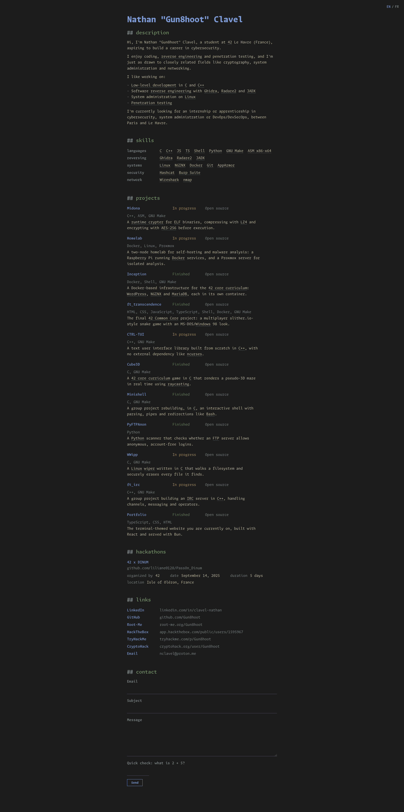

<div align="center">
	<h1>Portfolio of Nathan "Gun8hoot" CLAVEL</h1>
</div>
<br>
	


<br>
<div align="center">
	<h1>Deploy</h1>
</div>

1. Make sure that bun is installed
```sh
/bin/bash -c 'if [ "$(which bun)" == "" ]; then echo -e "\e[31m[-] bun is not installed, go on https://bun.com/get to install it\e[0m"; xdg-open "https://bun.com/get"; else echo -e "\e[32m[+] bun is installed\e[0m"; fi;'
```
2. Clone the repository and go on the project folder
```sh
git clone https://github.com/gun8hoot/portfolio.git && cd portfolio
```
3. Install every dependency
```sh
bun i
```
4. Launch the web server in production mode
```sh
bun run start
```
- To launch the web server in developement mode
```sh
bun run dev
```
